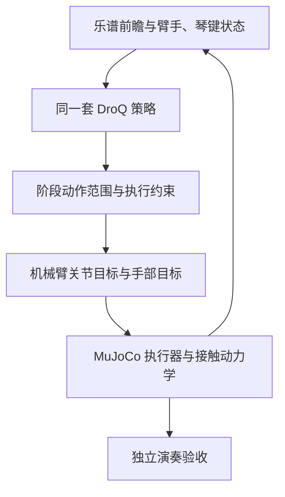

# 钢琴强化学习主线与臂手课程

决策日期：2026-11-14（Asia/Shanghai）。

[返回首页](../README.md) · [协作台账](ai_worklog.md) · [接触诊断与证据](piano_contact_diagnosis.md)

## 1. 主线决策与目标

后续集中推进 **RoboPianist＋RM75/L20＋DroQ 的直接策略学习**，使用仓内训练工程。近期目标是得到由学习策略连续输出动作、可重复展示的完整短句，再逐步扩大曲目和臂手运动范围。

传统控制已有曲目成果，保留作为演示和对照，后续不再以传统曲目开发为主线。学习演示必须由加载后的策略根据乐谱和当前状态产生动作；动作库回放、训练进程跑通、回报上升分别记录，不能替代策略演奏验收。

| 项目 | 主线选择 |
| --- | --- |
| 环境 | [仓内 RoboPianist](../third_party/robopianist/README.md) 的 RM75＋L20 Composer 接入 |
| 训练工程 | [仓内 RoboPianist RL](../experiments/robopianist_rl/README.md)，入口 `rm75.py` |
| 单音复现 | [T-0055 DroQ 单音基线](../experiments/droq_single_note/README.md)，使用独立 Python 环境和冻结任务源码 |
| 算法 | DroQ，近期不并行展开 SAC 算法对照 |
| 策略职责 | 依据乐谱前瞻、臂手及琴键状态，输出连续的关节/手部控制目标 |
| 起步范围 | 可达短片段与受限动作范围；固定腕位不合适时允许提前引入必要腕部运动 |
| 结果判断 | 实际按下、保持、释放、误触、时序与物理约束，独立重载后复验 |

选择依据是集中复用已有臂手接口、训练、检查点恢复和周期评估流程；**现有实验没有证明 DroQ 优于其他路线**，本决策不作算法优越性结论。

本页记录后续研发方向与课程设计，不是新的实验结果或临时进度表。任务认领、实际进展与验证记录继续以协作台账为准。本次文档落地不停止其他聊天的在途任务，不解除其文件占用，也不自动批准模型参数修改或真机运行。

## 2. 现有路线的定位

| 路线 | 学习对象或用途 | 后续定位 |
| --- | --- | --- |
| 参考轨迹＋残差 PPO | 修正已有手指参考动作，机械臂跟随参考 | 保留代码、模型和结果，暂缓新增实验 |
| 仓内直接控制 PPO | 固定双臂基础环境中的 ROOT/TIP 连续控制 | 保留，暂缓新增实验 |
| 动作库上的 PPO | 固定腕换指、动作时长、横移时机、相对键位选择 | 保留隔离实验，暂缓继续分叉 |
| RoboPianist SAC/DroQ | 统一任务环境中的臂手直接控制 | 唯一学习主线，算法固定 DroQ |
| BC 初始化、人体动作示范接入 | 初始化策略或提供动作先验 | 保留已有数据与工具，近期不作为新增训练支线 |
| 传统规划与标定回放 | 已有曲目演示、对照和诊断 | 保留已有成果，不继续扩大传统演奏开发 |

接触诊断属于主线的环境验证工作。诊断用反馈控制器可以检验物理可行性，其成功不能直接记作学习策略成功。已有曲目轨迹也不能直接充当本主线的动作标签，必须先验证模型、动作语义、控制周期及实际执行的一致性。

历史路线的实现和实验说明保留在 [残差 PPO](piano_rl.md)、[仓内直接控制与动作库实验](piano_direct_rl.md)、[示范数据](piano_imitation_data.md)。这些文档中的旧研究计划不代表本次重新授权启动所有路线。

## 3. 机械臂是最终策略的一部分

### 已有接口

完整动作接口为 **47 维**，顺序为右臂 7＋右手 16＋左臂 7＋左手 16＋延音 1。

| 部分 | 维度 | 动作含义与职责 |
| --- | --- | --- |
| 双 RM75 机械臂 | 14 | 各臂七个关节位置目标；移动到目标键区、调整腕部位置与朝向、支撑触键 |
| 双 L20 手 | 32 | 各手十六个有效命令通道，经耦合映射成为手部关节目标；完成按下、保持、释放 |
| 延音 | 1 | 钢琴环境的延音控制；不表示真实踏板执行机构已经接入 |

当前适配器将臂手动作映射后写入 MuJoCo 执行器目标，策略输出并非电机力矩。接口包含机械臂，不等于训练后的策略已经学会正确换位或双臂协作。

仓内提供 [训练入口](../experiments/robopianist_rl/rm75.py)、[接入说明](../experiments/robopianist_rl/RM75.md)、[任务环境](../third_party/robopianist/robopianist/suite/tasks/piano_with_rm75_l20.py) 和 [动作映射](../third_party/robopianist/robopianist/models/hands/rm75_l20.py)。远端隔离任务副本应按实际源码版本核对。

### 后续控制结构

课程保持完整接口的动作语义，按阶段限制可活动通道和范围，未开放部分保持明确的准备目标；机械臂从受限运动逐步过渡到更完整的协调控制，不另建一条独立机械臂学习路线。

关节范围、速度、加速度及碰撞约束需要在执行层明确设计和验证。奖励惩罚不能替代执行约束；本页不宣称现有适配器已具备全部限速、限加速度或在线避碰能力。历史实验的违规惩罚、终止方式应保留在对应配置中，后续变更单独记录。

## 4. 同一主线内的分阶段课程

以下是后续设计与验收目标，不表示各阶段已实现或通过。阶段晋级依据物理验收，不只依据步数或训练回报。

| 阶段 | 动作范围与任务 | 晋级所需证据 |
| --- | --- | --- |
| 0：建立训练基线 | 固定模型、场景、接触参数、控制周期和短片段；在策略实际可用的动作接口下复现按放 | 原谱时序内按下、持续保持、完整释放，无不允许的碰撞、限位、误触和尾部残留；保存实际施加动作及来源 |
| 1：受限手指学习 | 合适且可达的腕位；先开放目标手指必要通道 | 保存并独立重载策略，在预先固定的评估初态/种子下重复完成单音或重复音，报告实际边沿和失败次数 |
| 2：单臂单手短句 | 有限开放该侧机械臂与手指动作，另一侧保持准备目标 | 连续完成换指、邻键和必要换位，整段时序及约束通过，不能以单音分别通过代替短句通过 |
| 3：扩大键区与运动范围 | 扩展腕位可移动范围和完整短句 | 检查松键—换位—重新触键的连续协调，在预先固定的留出片段上报告覆盖范围及失败 |
| 4：双臂双手协同 | 两侧共同参与演奏 | 同时演奏、换位和相互避碰通过联合验收，保存整段实际琴键事件与状态 |

**固定机械臂只是可选的起步限制。** 如果腕位不合适、手指单独运动无法完成合格按放，应返回阶段 0 检查可达性与接触，并提前引入阶段 2 所需的有限腕部运动。不能把有限搜索失败当成所有控制方式均不可行，也不能让手指策略长期补偿错误的初始腕位。

各阶段训练前应冻结片段、原谱时序、动作范围、物理参数、控制周期、验收容差和评估初态/种子。保持已有严格判据；若必须改变参数或标准，应单独说明原因并生成新基线，不能混合统计为同一实验的收益。

## 5. 当前准入问题：接触成功尚未等同策略可用

截至本次文档核对，[2026-11-13 接触诊断记录](piano_contact_diagnosis.md)给出的证据边界是：

- 原接触参数下，已测试候选尚未通过干净、持续、准时的按放验收；有限候选失败不构成全局不可行证明。
- 隔离实验将指腹 `solref` 从 0.02 改为 0.004，并将物理步长从 2 ms 改为 1 ms，配合高频反馈控制器获得合格单音；该结果依赖接触模型修正，未自动成为正式基线。
- 成功案例使用 1 kHz 模型反馈控制器，现有策略默认控制周期为 50 ms。两者的动作生成和更新机制不同，不能只把成功轨迹降采样就认定策略接口可复现。
- 诊断记录仍标为 `training_ready=False`。接受哪一版接触基线，以及如何在策略动作接口下实现合格按放，仍需后续确认和验证。

因此，下一项技术工作属于阶段 0：核对并固定接触基线，在真实策略动作范围和控制周期下复验按放。物理子步加密不等于策略决策频率提高；是否调整策略周期，应在同一训练工程内评估，而非复制新的训练路线。

本次路线决策不自动采纳上述接触参数修改，也不把诊断控制器的力反馈作为现有策略已经具备的观测或动作能力。

## 6. 演示验收与真机边界

近期交付目标是一个由保存后的策略独立重载并连续执行、可重复展示的完整短句。每次评估至少保留：

- 乐谱、片段范围、模型/场景/参数版本、训练与评估种子、动作范围及控制周期。
- 实际按下/释放边沿、持续时间、漏音、误触、末尾残留及逐音误差；逐帧 F1 作为补充。
- 碰撞、关节/琴键越限、数值失稳、执行约束介入记录及完整失败案例。
- 检查点、实际施加动作、状态记录、评估报告和演示视频；区分最后模型与选中模型。

是否学会演奏，以相同任务、物理条件和判据下的重复物理验收为准。训练步数、总回报、接口测试通过和一次触键均不能单独作为演奏成功结论；单曲成功也不证明新曲泛化。

当前主线是仿真学习。真机部署还需确认可获得的观测、策略目标到现有 RM75/L20 驱动的转换、实际控制频率与延迟、限位和停止行为，并单独进行现场验收。MuJoCo 47 维接口不等于真机控制链已经接通，软件停止也不等同机械急停。

本页仅记录决策与验证要求；本次文档编辑没有新增构建、训练、仿真或真机验证结果。
